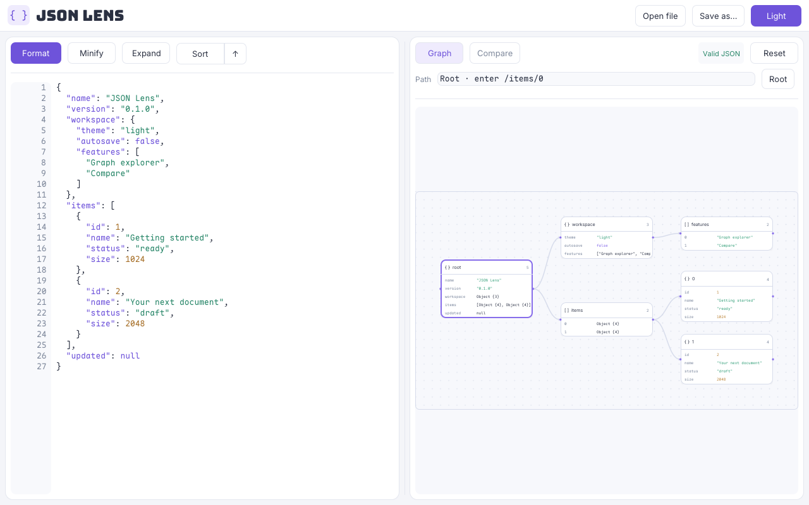
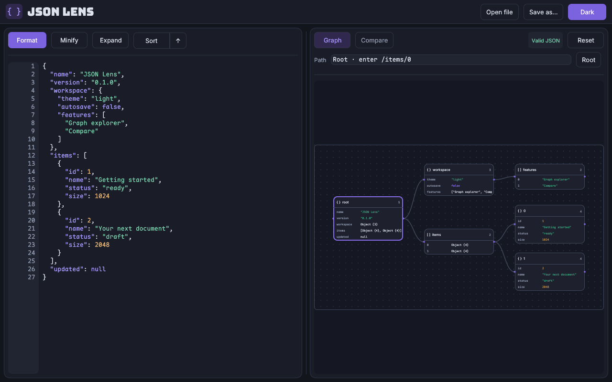
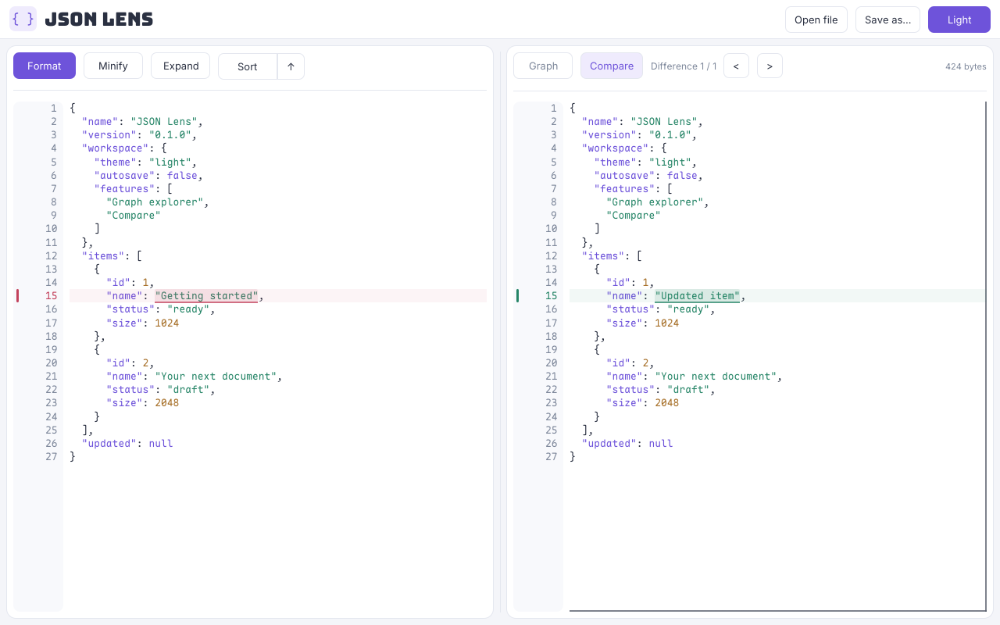
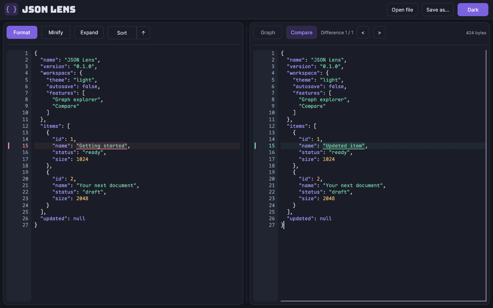

# JSON Lens

A Rust JSON editor for desktop and browser. Explore JSON as a graph, or paste two
documents for an automatic, aligned comparison.

[Open web app](https://sihaixianyu.github.io/json-lens/) · [Desktop downloads](https://github.com/sihaixianyu/json-lens/releases)

## UI

| Light | Dark |
| --- | --- |
|  |  |
|  |  |

Inter for UI, Maple Mono CN for code. Follows the system theme by default;
click **Light / Dark** to override it.

## Key features

- **Automatic comparison:** paste JSON on the right; differences highlight automatically, with aligned rows, fixed gutters and linked scrolling.
- **Graph ↔ source navigation:** click a value to locate it on either side. Arrays retain indexed element nodes; drag cards, fold branches or reset the bounded canvas.
- **Fast editing workflow:** Format, Minify, recursive Sort and Expand JSON encoded in strings. **Ctrl/Cmd + S** formats the active editor; **Ctrl/Cmd + Z** undoes, **Ctrl/Cmd + Shift + Z** or **Ctrl/Cmd + Y** redoes. Tab indents with two spaces. **Ctrl/Cmd + F** toggles search; **Ctrl/Cmd + wheel** zooms the graph.
- **Readable strings:** both editors wrap long lines automatically. Hover encoded strings for Base64, URL, Hex or nested JSON previews without changing the document.
- **Precise JSON:** preserves object key order and arbitrary-precision numbers. Open JSON/CSV and save JSON; browser files stay local.
- **Desktop + WebAssembly:** native GPU rendering through wgpu, with WebGPU/WebGL2 in the browser.

## Performance

Same JSON array inputs on Apple M4 Pro / macOS, release Rust 1.95.0 vs Node.js
26.12.1 (V8), measured on 2026-10-29. Median of 11 runs after 3 warmups; ms.
Native JSON Lens uses SIMD and a **14-thread Rayon pool** for large arrays;
JS parsers are single-threaded.

| Input | Original serde parse | JSON Lens parse | JS `JSON.parse` | TS `jsonc-parser` parse | JSON Lens cached format | JS cached format |
| --- | ---: | ---: | ---: | ---: | ---: | ---: |
| 1 MiB | 5.04 | 1.53 | 1.83 | 16.85 | 1.70 | 2.62 |
| 5 MiB | 26.95 | 6.00 | 9.30 | 66.13 | 10.09 | 14.72 |
| 20 MiB | 106.20 | 23.66 | 44.09 | 278.67 | 36.69 | 59.10 |

The native parsing path is **3.3–4.5× faster than the original serde path** and
**1.2–1.9× faster than V8** on these arrays. With one worker, 20 MiB parsing
is about 78 ms versus 104 ms for serde and 44 ms for V8. The default speedup
includes parallelism and uses extra temporary memory.
These measurements exclude file I/O, graph layout and rendering.
[Methodology, single-thread results and reproduction commands](docs/performance.md).

WASM also uses **Sonic + SIMD128**. In Chrome, 20 MiB parsing dropped from
**121.8 ms to 92.6 ms** against serde in the same WASM build. JSON processing runs in a background Web Worker. [Browser results](docs/performance.md#webassembly-results).

Native processing uses background threads. In the browser, JSON processing,
Graph construction, Compare and search run in a Web Worker. The UI stays on
the main thread; no cross-origin isolation headers are required.

For a **1-million-character JSON** in Chrome, editor optimizations reduced
median scroll frame gaps from **83 ms to 16.7 ms**, and the largest frame gap
while opening from **417 ms to 117 ms**. [UI measurements](docs/performance.md#browser-editor-responsiveness).

## Run

```sh
cargo run --release --locked
# Optional file at startup:
cargo run --release --locked -- /path/to/document.json
```

Browser mode, with [Trunk](https://trunkrs.dev/) installed:

```sh
rustup target add wasm32-unknown-unknown
trunk serve --release
```

Open **http://127.0.0.1:8080**. `trunk build --release` generates `dist/` for
HTTPS or localhost hosting. WebGPU falls back to WebGL2 when unavailable.

DEBUG timing logs: native `JSON_LENS_LOG=debug cargo run --release --locked`;
web append `?debug=1` and enable **Verbose** in DevTools Console.
[Log fields and performance analysis](docs/debug.md).

## Releases and deployment

Version tags such as `v0.1.0` trigger [desktop packaging](.github/workflows/release.yml):
macOS Apple Silicon/Intel `.dmg`, Windows x86_64 setup/portable `.exe`, and
Linux x86_64 `.deb`/`.tar.gz` (built on Ubuntu 22.04). Publisher signing and
macOS notarization are not configured.

Pushes to `main` trigger [GitHub Pages](.github/workflows/pages.yml). First select
**Settings → Pages → GitHub Actions**, or configure `PAGES_SETUP_TOKEN` with
Pages read/write permission for automatic setup.
