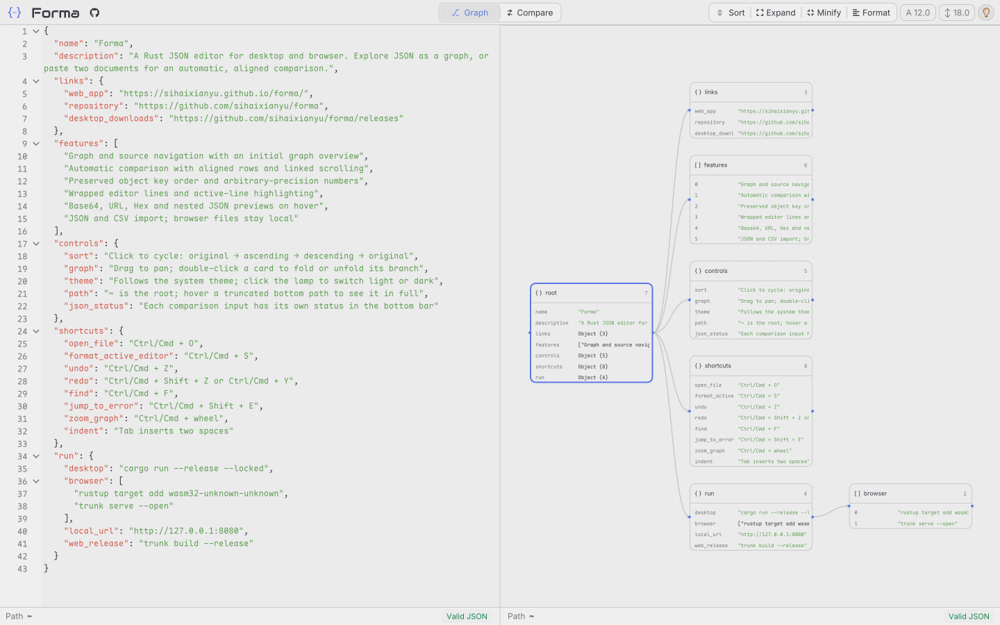
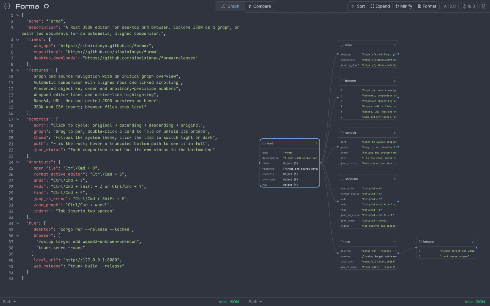
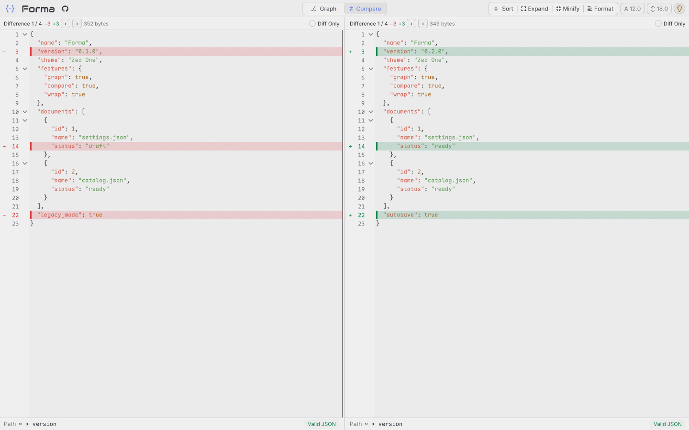
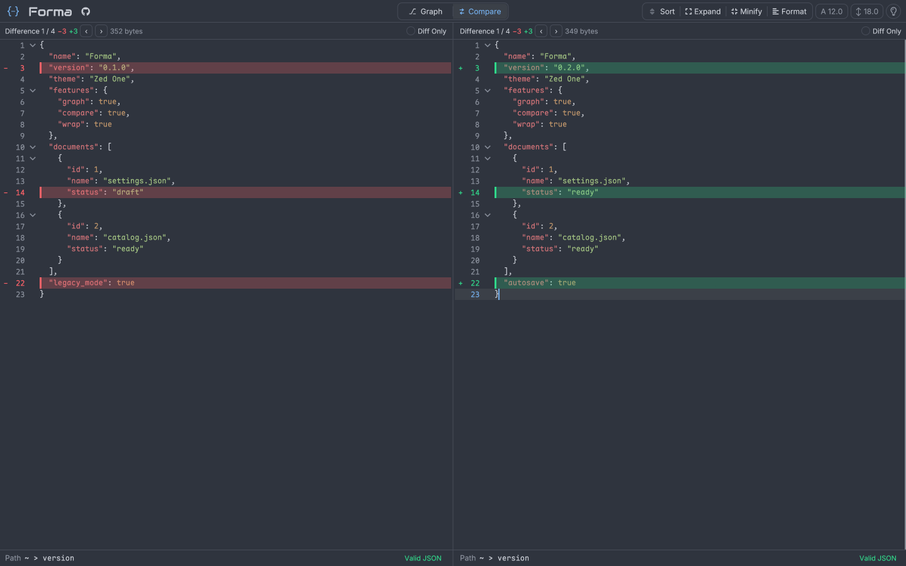

# Forma

A Rust JSON editor for desktop and browser. Explore JSON as a graph, or paste two
documents for an automatic, aligned comparison.

[Open web app](https://sihaixianyu.github.io/forma/) · [Desktop downloads](https://github.com/sihaixianyu/forma/releases)

## UI

| Light | Dark |
| --- | --- |
|  |  |
|  |  |

Audiowide for the title, Inter for UI, and Maple Mono CN for code.
The app follows the system theme by default; click the lamp in the top-right
toolbar to switch between Zed One Light and Zed One Dark. Syntax uses the original
Zed One colors; blue text-selection backgrounds stand apart from the red/green diff.

The compact top bar contains the logo, title and GitHub link on the left,
an animated Graph / Compare selector aligned with the editor divider, and
Sort, Expand, Minify and Format buttons with small icons on the right. Font-size
and line-height inputs sit between Format and the theme button and update both editors.
Editors default to a 12px font with an 18px line height.
Each pane has a fixed bottom bar with its path and JSON status. Paths start
with `~` for the root; hover a truncated path to see it in full. In Compare
mode, each status reports the validity of its own input independently.

The startup JSON is a bundled [quick-start guide](assets/example.json) with
features, controls, keyboard shortcuts, project links and run instructions from this README.

## Key features

- **Automatic comparison:** paste JSON on the right; shared object keys follow the left pane's order. Arrays automatically use a shared unique `id`, `_id`, `key` or `name` when available, then exact and similar content. Additions, removals, value/type changes and moves share one comparison model for row alignment, highlights, counts and navigation. Original right-side positions are retained when arranging the display.
- **Focused review:** the slim DIFF bar includes a **Diff Only** toggle. Long documents with a few changes automatically fold unchanged regions, retaining three context lines; use the gutter chevron to expand them. Editing expands the full input. Array matching is automatic, with no configuration controls or context menus; ambiguous matches are identified in the selected difference's tooltip.
- **Paste at the root:** pasting JSON places the caret and view at the document root immediately, without an animated trip to the end and back. Typing and keyboard navigation still scroll to follow the caret.
- **Git-style diff:** removed and added lines use stronger red/green backgrounds, colored edge bars and `−` / `+` gutter markers. Highlighting stays at line level; alignment gaps stay blank, and each pane reports its changed-line count.
- **Restore browser inputs:** both inputs and the Graph/Compare mode are saved locally in IndexedDB as they change and restored after refresh or a development rebuild. Use the same browser and site address; storage failures appear in the app.
- **Graph ↔ source navigation:** the initial view fits the graph overview into the pane. Click a value to locate it on either side, drag to pan, or double-click a card to fold or unfold its branch. Arrays retain indexed element nodes. Selecting a branch beyond the initial graph preview loads its local graph.
- **Fast editing workflow:** Format, Minify, Expand JSON encoded in strings, and a three-state recursive Sort: click to cycle through original order, ascending, descending, and back to the exact original text. In Compare mode, Sort applies to both panes and restores each pane's original text. The Sort icon highlights the active direction. **Ctrl/Cmd + S** formats the active editor; **Ctrl/Cmd + Z** undoes, **Ctrl/Cmd + Shift + Z** or **Ctrl/Cmd + Y** redoes. Tab indents with two spaces. **Ctrl/Cmd + F** toggles search; **Ctrl/Cmd + wheel** zooms the graph.
- **Active-line highlighting:** the focused editor highlights the current line, including wrapped rows, and accents its line number. Click a line number to move the caret to that line.
- **Readable strings:** both editors wrap long lines automatically. Hover encoded strings for Base64, URL, Hex or nested JSON previews without changing the document.
- **Code folding:** click the chevron beside a line number to fold or unfold a multiline object or array. Folding preserves the complete JSON and original line numbers; editing or jumping to a search result reveals the content again. Aligned comparison panes fold together.
- **Syntax diagnostics:** invalid JSON marks the error line in the editor gutter. Hover for details or click to move the cursor. Each pane's bottom status identifies invalid JSON independently, so an error in one comparison input does not mark the other as invalid. **Ctrl/Cmd + Shift + E** jumps to the error position.
- **Precise JSON:** preserves object key order and arbitrary-precision numbers. Open JSON/CSV with ⌘O / Ctrl+O; browser files stay local.
- **Desktop + WebAssembly:** native GPU rendering through wgpu, with WebGPU/WebGL2 in the browser.

## Performance

Same JSON array inputs on Apple M4 Pro / macOS, release Rust 1.95.0 vs Node.js
26.12.1 (V8), measured on 2026-10-29. Median of 11 runs after 3 warmups; ms.
Native Forma uses SIMD and a **14-thread Rayon pool** for large arrays;
JS parsers are single-threaded.

| Input | Original serde parse | Forma parse | JS `JSON.parse` | TS `jsonc-parser` parse | Forma cached format | JS cached format |
| --- | ---: | ---: | ---: | ---: | ---: | ---: |
| 1 MiB | 5.04 | 1.53 | 1.83 | 16.85 | 1.70 | 2.62 |
| 5 MiB | 26.95 | 6.00 | 9.30 | 66.13 | 10.09 | 14.72 |
| 20 MiB | 106.20 | 23.66 | 44.09 | 278.67 | 36.69 | 59.10 |

The native parsing path is **3.3–4.5× faster than the original serde path** and
**1.2–1.9× faster than V8** on these arrays. With one worker, 20 MiB parsing
is about 78 ms versus 104 ms for serde and 44 ms for V8. The default speedup
includes parallelism and uses extra temporary memory.
These measurements exclude file I/O, graph layout and rendering.
[Methodology, single-thread results and reproduction commands](docs/performance.md).

WASM also uses **Sonic + SIMD128**. In Chrome, 20 MiB parsing dropped from
**121.8 ms to 92.6 ms** against serde in the same WASM build. JSON processing runs in a background Web Worker. [Browser results](docs/performance.md#webassembly-results).

Native processing uses background threads. In the browser, JSON processing,
Graph construction, Compare and search run in a Web Worker. The UI stays on
the main thread; no cross-origin isolation headers are required.

Browser Find stays inside the app. Search runs in the Worker, reuses cached
source text, and highlights only visible matches without rebuilding the editor.

For a **1-million-character JSON** in Chrome, editor optimizations reduced
median scroll frame gaps from **83 ms to 16.7 ms**, and the largest frame gap
while opening from **417 ms to 117 ms**. [UI measurements](docs/performance.md#browser-editor-responsiveness).

## Run

```sh
cargo run --release --locked
# Optional file at startup:
cargo run --release --locked -- /path/to/document.json
```

`cargo build --release --locked` writes `target/release/forma`
(`target/release/forma.exe` on Windows).

Browser mode, with [Trunk](https://trunkrs.dev/) installed:

```sh
rustup target add wasm32-unknown-unknown
trunk serve --open
```

Open **http://127.0.0.1:8080**. `trunk build --release` generates `dist/` for
HTTPS or localhost hosting. WebGPU falls back to WebGL2 when unavailable.

Debug builds automatically record the low-volume caret/Path/Graph trace. Native
`cargo run` writes `forma-debug.log`; set `FORMA_LOG_FILE=/path/to/file` to change it.
Full timing logs remain opt-in with `FORMA_LOG=debug`. Web debug builds write the
navigation trace to DevTools Console. For an agent-readable local Web log, start
with `python3 scripts/debug-web.py --open`; events are written to `forma-debug.log`.
Release Web builds require `?debug=1`.
[Log fields and performance analysis](docs/debug.md).

## Source layout

`src/main.rs` and `src/lib.rs` are the application and library entry points.
The `core/` directory holds JSON processing, `app/` holds document jobs and
search state, `ui/` holds workspace and editor presentation, `browser/` holds
web startup, and `worker/` holds browser background execution. The top-level
`app.rs`, `ui.rs`, `canvas.rs` and `worker.rs` are their main modules.

Production files target roughly 500 lines (usually 300–550), with responsibility
boundaries taking priority over exact line counts. Tests live beside their
owning modules. Application lifecycle, pane rendering and canvas geometry have
separate modules because they have distinct responsibilities.

Run `cargo test --locked --all-features` for processing and UI regressions.

## Releases and deployment

Version tags such as `v0.1.0` trigger [desktop packaging](.github/workflows/release.yml):
macOS Apple Silicon `.dmg`, Windows x86_64 setup/portable `.exe`, and
Linux x86_64 `.deb`/`.tar.gz` (built on Ubuntu 22.04). Publisher signing and
macOS notarization are not configured.

Release filenames use `forma-<platform>-<arch>-<version>`; the macOS app bundle
is `Forma.app` and the installed executable is `forma` (`forma.exe` on Windows).

Pushes to `main` trigger [GitHub Pages](.github/workflows/pages.yml). First select
**Settings → Pages → GitHub Actions**, or configure `PAGES_SETUP_TOKEN` with
Pages read/write permission for automatic setup.
