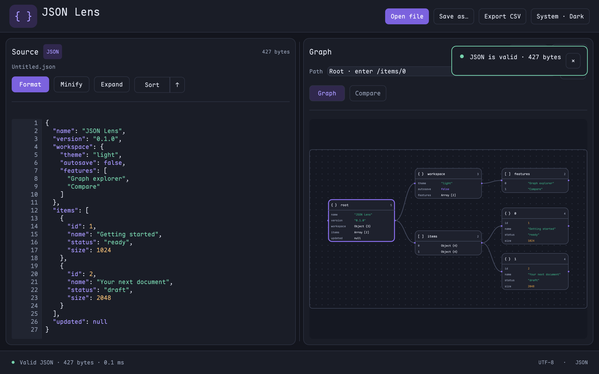
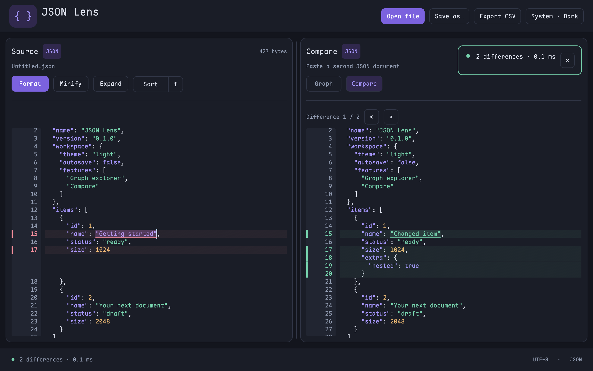

# JSON Lens

A Rust JSON editor for native desktop and WebAssembly, built with egui and wgpu.

## UI

| Graph — default view | Compare — paste a second JSON |
| --- | --- |
|  |  |

Maple Mono CN for JSON code; Inter for interface text and graph headings.
Follows the system theme by default; click the theme
button to switch Light / Dark. [Browser UI](docs/screenshots/web.png).

## Features

- **Editor:** syntax highlighting, line numbers, validation, Format, Minify, Sort and Expand nested JSON.
- **Graph:** bounded pan/zoom, draggable cards, branch folding and layout reset. Arrays show element indexes, value summaries and connections.
- **Navigation:** click source text to locate its graph node, or graph values to reveal their source.
- **Compare:** paste on the right for automatic diff highlighting, aligned rows and linked vertical scrolling.
- **Search:** Ctrl/Cmd + F toggles search in the active pane. Ctrl/Cmd + wheel zooms the graph.
- **Files:** open JSON/CSV and save JSON. Preserves object key order and number precision.

## Performance

Recorded release benchmarks on Apple M4 Pro / macOS; median of 7 runs.

| Input | Parse | Format cached JSON | Minify cached JSON |
| --- | ---: | ---: | ---: |
| 1 MiB | 6.16 ms | 1.33 ms | 0.68 ms |
| 5 MiB | 24.69 ms | 7.49 ms | 4.34 ms |
| 20 MiB | 98.94 ms | 30.77 ms | 18.11 ms |

Native JSON processing runs on background CPU workers; wgpu accelerates rendering.
These timings measure JSON processing, excluding file I/O and UI rendering.
The browser version schedules CPU work between frames on the main thread;
large documents can briefly pause the UI. The table above measures the native build.

## Run

```sh
cargo run --release --locked
```

Pass a file path to open it at startup:

```sh
cargo run --release --locked -- /path/to/document.json
```

Browser mode (install [Trunk](https://trunkrs.dev/) first):

```sh
rustup target add wasm32-unknown-unknown
trunk serve --release
```

Open **http://127.0.0.1:8080**. Use `trunk build --release` to create a static site
in `dist/`; serve it over HTTPS or localhost. WebGPU is used when available,
with WebGL2 as a fallback. Files stay in your browser: Open imports JSON/CSV,
and Save downloads JSON without uploading it.

GitHub Pages: select **Settings → Pages → Source → GitHub Actions** once.
Pushes to `main` then build and deploy automatically using
[pages.yml](.github/workflows/pages.yml).
The site URL is **https://sihaixianyu.github.io/json-lens/**.
For automatic first-time setup, add a `PAGES_SETUP_TOKEN` repository secret
(fine-grained PAT with Pages read/write). The default `GITHUB_TOKEN` cannot
create the Pages site; a 404 from `configure-pages` means setup is still needed.

## Desktop releases

Push a version tag such as `v0.1.0`, or run **Build Release** from Actions.
The workflow publishes these files to GitHub Releases:

| Platform | Packages |
| --- | --- |
| macOS, Apple Silicon / Intel | `.dmg` containing `JSON Lens.app` |
| Windows x86_64 | Setup `.exe` and portable `.exe` |
| Linux x86_64 | `.deb` for Debian/Ubuntu and portable `.tar.gz` |

Linux binaries are built on Ubuntu 22.04. macOS and Windows packages are
unsigned; Developer ID notarization and Windows publisher signing are not configured.

Run the benchmarks:

```sh
cargo bench --bench processing --locked
cargo bench --bench workspace --locked
```
